<div align="center">

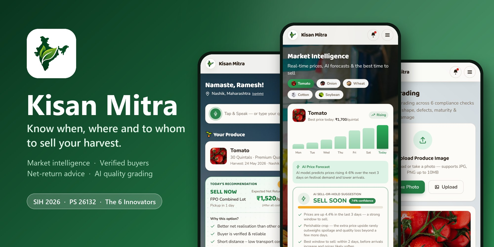

<br/>


**A mobile-first marketplace that tells farmers _when_, _where_ and _to whom_ to sell — then carries the decision through to delivery and payment.**

[Live demo](https://vinay-alla.github.io/KISAN-MITRA/) · [Screenshots](#-screenshots) · [Features](#-features) · [How it works](#-how-the-intelligence-works) · [Architecture](#%EF%B8%8F-architecture) · [Run locally](#-getting-started)

</div>

> **Prototype notice.** Mandi prices, buyers, offers, orders and verification records are illustrative mock data. The "AI" features are rule-based or simulated — there is no trained model behind them. Details in [Known limitations](#%EF%B8%8F-known-limitations).

---

## 📖 Overview

Smallholder farmers usually sell right after harvest, under cash pressure, with little view of mandi prices, buyer demand, quality specs, transport or storage. Buyers struggle to source consistent volume from scattered producers, and payment reliability is opaque.

**Kisan Mitra** is a response to Smart India Hackathon 2026 **Problem Statement 26132 — _Strengthening market linkages and price discovery for farmers_**. It gives each of three roles a purpose-built view of the same marketplace:

| Role | What they get |
|---|---|
| 🧑‍🌾 **Farmer** | Live price context, an explainable sell-or-hold call, net-return comparison across buyers and mandis, reverse bidding, quality pre-grading, logistics, order tracking and receipts |
| 🏢 **Buyer** | Browse verified lots, bid on produce, track offers, see verified farmers & FPOs, manage a business profile with its own verification status |
| 🤝 **FPO operator** | Member and pooled-lot overview, verified buyers, market view |

### At a glance

| | |
|---|---|
| **Roles** | 3 (farmer, buyer, FPO operator) with role-based route access |
| **Screens** | 25 page renderers across 19 routes |
| **Languages** | English, हिंदी, मराठी — UI, voice input and spoken replies |
| **Codebase** | ~5,500 lines of JavaScript, no framework, no build step |
| **Tests** | 120 automated tests (Node's built-in runner, zero dependencies) run on every push |
| **Offline** | Installable PWA with a cached app shell |
| **External services** | Open-Meteo, OpenStreetMap Nominatim, optional data.gov.in mandi feed — each degrades gracefully |

---

## 📸 Screenshots

<div align="center">

<table>
<tr>
<td align="center" width="33%">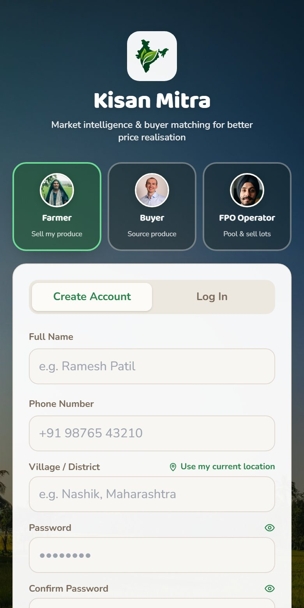<br/><b>One app, three roles</b><br/><sub>Farmer, buyer or FPO operator — sign up or try a demo account</sub></td>
<td align="center" width="33%">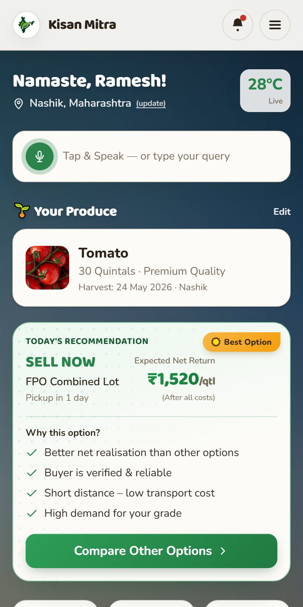<br/><b>Today's recommendation</b><br/><sub>Best option and expected net return, with the reasons why</sub></td>
<td align="center" width="33%">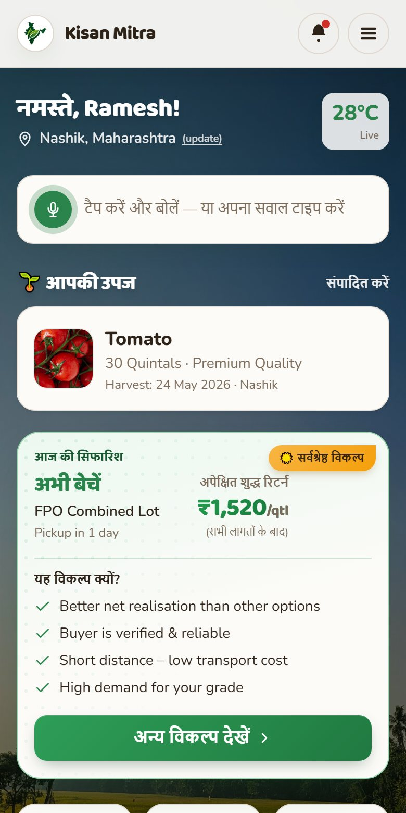<br/><b>Fully multilingual</b><br/><sub>The same screen in हिंदी — मराठी is one tap away</sub></td>
</tr>
<tr>
<td align="center">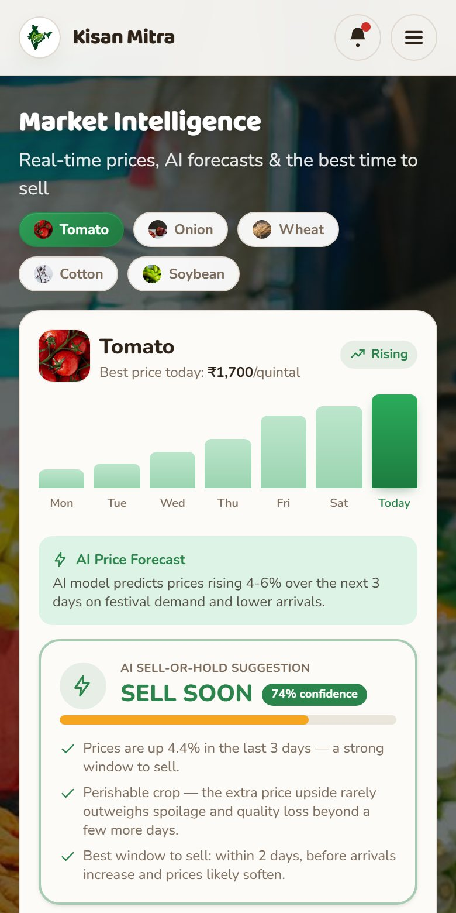<br/><b>Market intelligence</b><br/><sub>7-day trend, price forecast and an AI sell-or-hold verdict</sub></td>
<td align="center">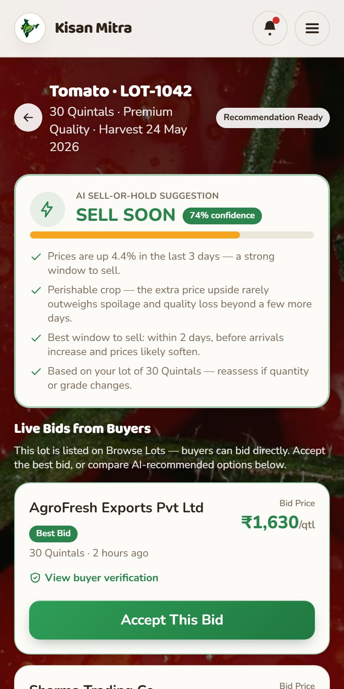<br/><b>Bids &amp; net-return options</b><br/><sub>Reverse bidding plus transparent cost breakdowns</sub></td>
<td align="center">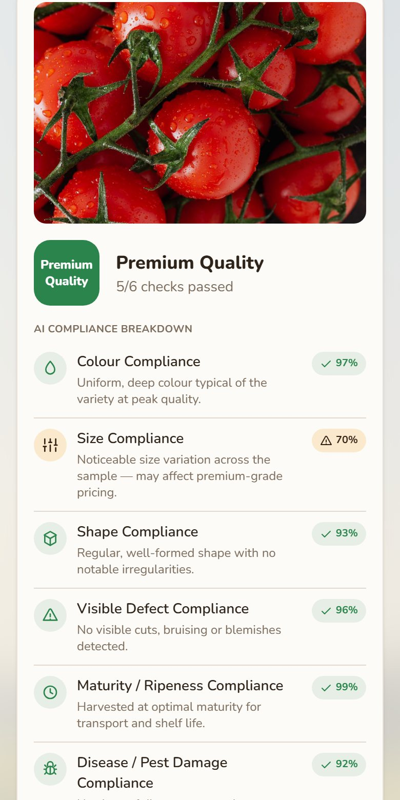<br/><b>AI quality pre-grading</b><br/><sub>Six compliance checks from a single photo</sub></td>
</tr>
<tr>
<td align="center">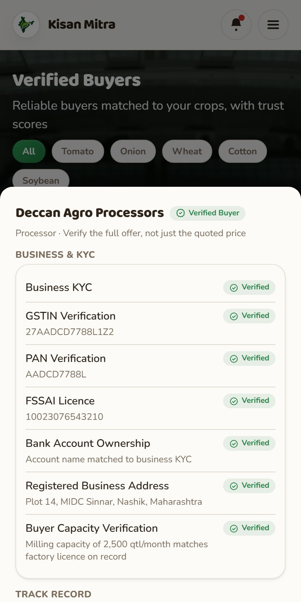<br/><b>Buyer verification</b><br/><sub>GSTIN, PAN, FSSAI, bank, capacity, payment score</sub></td>
<td align="center">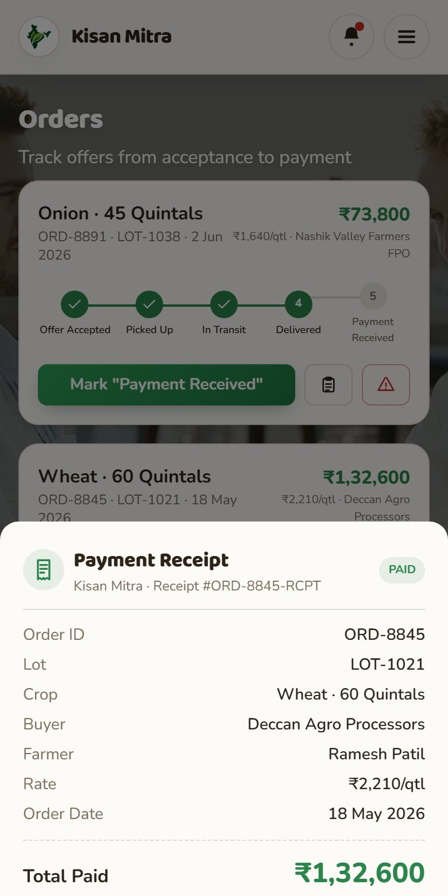<br/><b>Payment receipt</b><br/><sub>Printable, generated once an order reaches payment</sub></td>
<td align="center">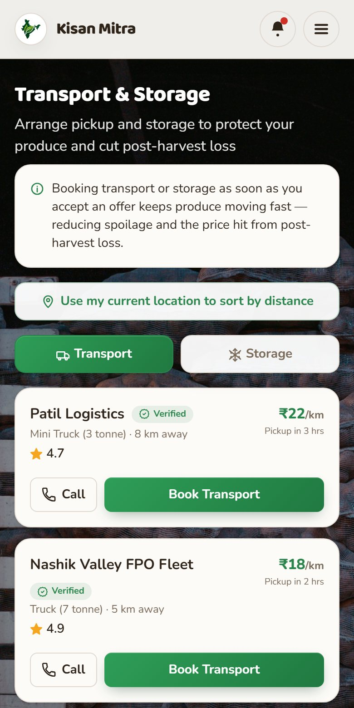<br/><b>Transport &amp; storage</b><br/><sub>Providers sorted by live distance from your GPS position</sub></td>
</tr>
<tr>
<td align="center">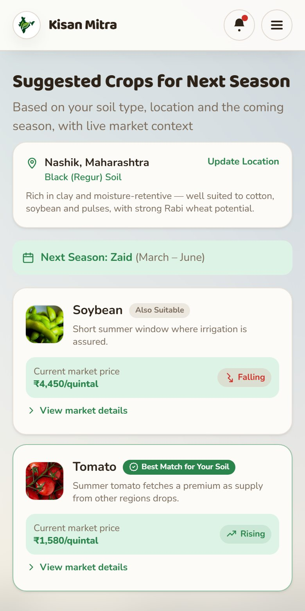<br/><b>Next-season crops</b><br/><sub>Soil type + location + season, with live price context</sub></td>
<td align="center">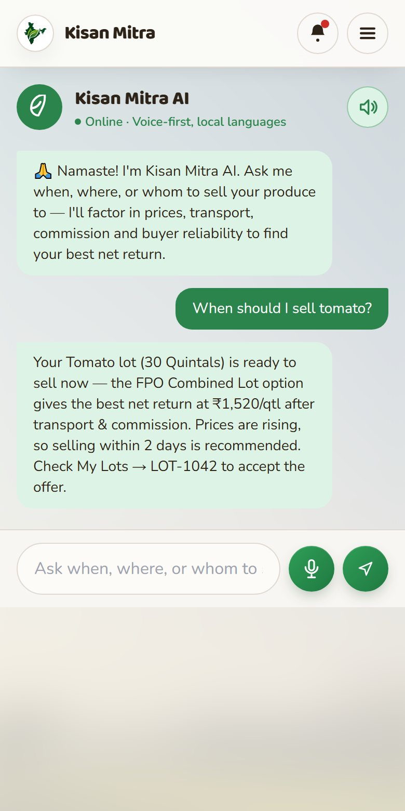<br/><b>Voice assistant</b><br/><sub>Speak or type in your language and hear the answer</sub></td>
<td align="center">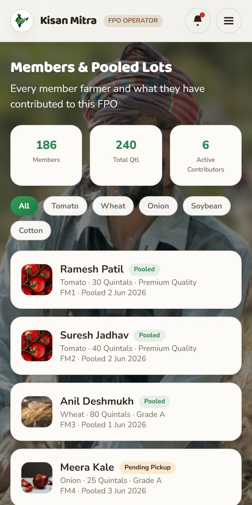<br/><b>FPO operator view</b><br/><sub>Every member's pooled lot and its status</sub></td>
</tr>
<tr>
<td align="center">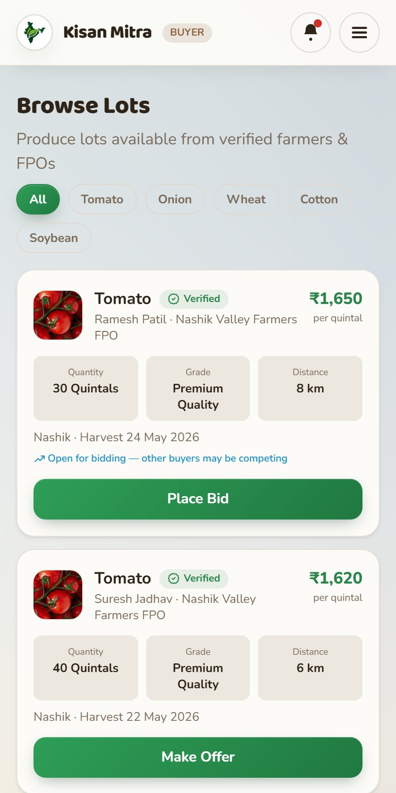<br/><b>Buyer: browse lots</b><br/><sub>Verified farmers and FPOs, ready to bid on</sub></td>
<td align="center">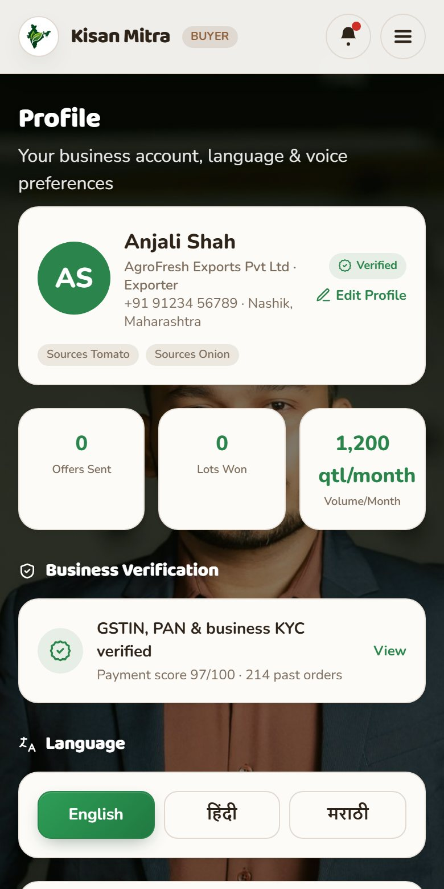<br/><b>Buyer: business profile</b><br/><sub>Own verification status, sourcing crops, volume</sub></td>
<td></td>
</tr>
</table>

</div>

---

## ✨ Features

### 🧑‍🌾 For farmers
- **Market intelligence** — mandi-wise prices, a 7-day trend chart, a price forecast and an explainable **Sell now / Sell soon / Hold** verdict with a confidence score.
- **Net-realisation comparison** — every option is scored on what the farmer actually keeps (price − transport − commission − storage), not the headline price.
- **Lots with reverse bidding** — list a lot with a photo and location, receive live bids, accept the best one.
- **24-hour cancel window** — back out of an accepted offer before the buyer arranges pickup.
- **Order tracking** across five stages, a digital transaction record and a **printable payment receipt**.
- **Grievance centre** — raise a quality, payment, logistics or buyer-unreachable issue (optionally tied to an order) and follow it through *Submitted → Under Review → Resolved*. Grievances persist per account; the status steps are advanced by a clearly-labelled demo button because there is no real support desk.
- **AI visual pre-grading** — six compliance checks (colour, size, shape, visible defects, maturity, disease/pest damage) and an overall grade.
- **Buyer verification** — a full KYC checklist and track record behind every "Verified" badge; processor offers get a full-offer check, not just the quoted price.
- **Dynamic FPO pooling** — open pooling rounds with volume price tiers. Commit quintals from your own lots; when the pool crosses a tier the price rises *for every member*, and the app shows how much extra you earn and which tier your quantity unlocked.
- **Transport & storage** — providers sorted by real distance from the device's GPS position.
- **Storage economics calculator** — pick a crop, quantity, facility and holding period to see whether storing beats selling today after spoilage and storage cost, with a 3/7/14/21-day comparison. Estimates assume the recent price trend continues at 40% strength and say so.
- **Shared transport** — book a seat on a truck other farmers are filling; the trip cost is split across every quintal on board, so your per-quintal cost falls as it fills, with the saving versus hiring a vehicle alone.
- **Weather forecast** — live conditions and a 5-day outlook from Open-Meteo.
- **Next-season crop suggestions** — recommendations from soil type, location and the coming season (Kharif / Rabi / Zaid).

### 🏢 For buyers
Browse verified lots, place offers and bids, track their status, view verified farmers and FPOs, and manage a business profile that shows their own verification state.

### 🤝 For FPO operators
A members-and-pooled-lots dashboard, verified buyers, the market view and the grievance centre.

### 🌐 Across the app
- **Trilingual** — English / हिंदी / मराठी for the interface, the voice input and the assistant's replies.
- **Voice assistant** — speech-to-text input and text-to-speech output via the Web Speech API, with keyword-based intent detection in all three languages.
- **Location-aware** — one-tap "use my location" with reverse geocoding.
- **Installable PWA** — cached app shell for flaky rural connectivity.
- **Accessible** — skip link, labelled controls, focus-trapped dialogs that restore focus, `aria-live` toasts, keyboard-operable menus and `prefers-reduced-motion` support.
- **Resilient** — an error boundary with a *Try again / Reset saved data* page, hostile or corrupt `localStorage` is sanitised on load, and a warning appears if the browser can't save.

---

## 🧠 How the intelligence works

Everything below is deterministic and inspectable — the recommendations are *explainable*, which is the point.

### 1. Net realisation — what the farmer actually keeps

```
net per quintal = base price − transport − commission − storage
```

Worked example for a 30-quintal tomato lot:

| Option | Base | Transport | Commission | **Net / qtl** | Note |
|---|---:|---:|---:|---:|---|
| **FPO Combined Lot** (AgroFresh) | ₹1,650 | ₹80 | ₹50 | **₹1,520** | ✅ Best — verified buyer, short distance |
| Sharma Trading Co. | ₹1,500 | ₹20 | ₹0 | ₹1,480 | ⚠️ Unverified — payment risk flagged |
| Lasalgaon Mandi | ₹1,700 | ₹150 | ₹80 | ₹1,470 | Highest headline price, but 3rd on net |
| Nashik APMC Mandi | ₹1,580 | ₹40 | ₹90 | ₹1,450 | Standard commission erodes the return |

The mandi with the highest price ranks third once real costs are counted — and the second-best net offer carries a visible trust warning.

### 2. Sell or hold — an explainable verdict

Combines 3-day / 7-day price momentum, the forecast direction and **crop perishability** (tomato and onion lose value fast; wheat, cotton and soybean store well).

| Forecast | Perishable crop | Non-perishable crop |
|---|---|---|
| Falling | **SELL NOW** (92%) | **SELL NOW** (78%) |
| Rising | **SELL SOON** (74%) — spoilage risk outweighs extra upside | **HOLD** (81%) — safe to wait |
| Stable | **SELL NOW** (65%) | **HOLD** (65%) |

Each verdict ships with plain-language reasons (e.g. *"Prices are up 4.4% in the last 3 days — a strong window to sell"*).

### 3. Quality pre-grading — six compliance checks

| Check | Looks at |
|---|---|
| Colour | Uniformity and depth of colour for the variety |
| Size | Fit within the standard grading bracket |
| Shape | Regularity and form |
| Visible defects | Cuts, bruising, blemishes |
| Maturity / ripeness | Harvest readiness for transport and shelf life |
| Disease / pest damage | Signs of disease or insect damage |

Each check scores 70–99% (pass at ≥ 85%); the average maps to **Premium Quality** (≥ 90), **Grade A** (≥ 78) or **Grade B**. *In this prototype the scores are derived deterministically from the photo's name and size — a stand-in for a real vision model — so the same photo always grades the same way.*

### 4. Buyer verification — what's behind a "Verified" badge

| Business & KYC | Track record |
|---|---|
| Business KYC · GSTIN · PAN · FSSAI licence (where food is handled) · bank-account ownership · registered address · capacity | Transaction history · payment-performance score · order-fulfilment rate · dispute history |

An unverified trader shows red flags across the board; a cotton mill correctly shows FSSAI as *not applicable*.

### 5. Next-season crop suggestions

State → typical **soil type** lookup, then the **calendar month** → current season → next season (Kharif → Rabi → Zaid). Crops are filtered by soil suitability and tagged *Best Match* or *Also Suitable*, each with the live market price and trend.

---

## 🗺️ Farmer journey

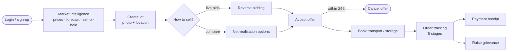

---

## 🏗️ Architecture

A static single-page app — no framework, no bundler, no backend required. Pages are plain functions that return HTML plus a `mount()` hook.

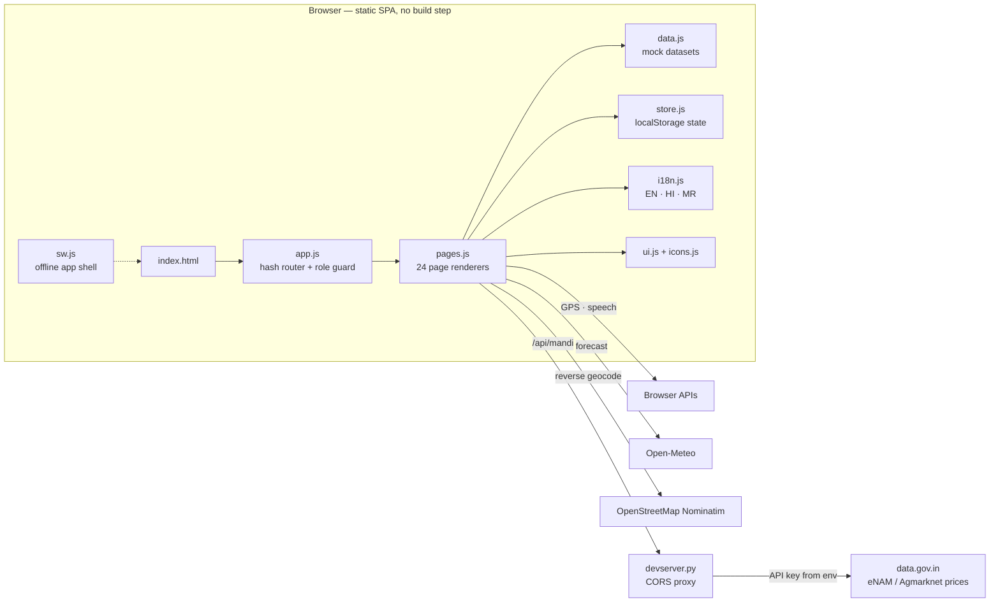

### Project structure

```
index.html         app shell — Tailwind CDN, fonts, service-worker registration
manifest.json      PWA manifest
sw.js              service worker: cached app shell; live API calls bypass the cache
devserver.py       local static server + /api/mandi proxy
css/style.css      global styles, photo-backdrop and card system
js/app.js          router, header, bottom nav, role-based access control
js/pages.js        every page renderer and its event wiring
js/data.js         mock datasets, nav config, crop/soil planning data
js/logic.js        pure business logic: net returns, sell-or-hold, storage economics,
                   pooling tiers, shared-trip costs, grievances, grading, access rules
js/util.js         pure helpers: HTML escaping, money/number/phone formatting, distance
js/crypto.js       PBKDF2-HMAC-SHA-256 password hashing (Web Crypto + pure-JS fallback)
js/store.js        localStorage-backed state, with sanitising of untrusted saved data
js/i18n.js         English / Hindi / Marathi dictionary
js/icons.js        SVG icon set, image nav icons, logo
js/ui.js           toast and accessible modal helpers
tests/             node --test suites: logic, util, crypto, store, data integrity, page rendering
.github/workflows/ ci.yml (tests on Node 20 & 22) and pages.yml (tests gate the deploy)
assets/            photos, icons, logo
docs/              README banner and screenshots
```

### Engineering decisions worth noting

- **No framework, no build step.** ES modules and hash routing keep it deployable to any static host and make the data flow easy to follow.
- **Role-based access in one table.** A single `ROLE_RESTRICTED_PATHS` map drives route guarding, so adding a role doesn't mean untangling nested conditionals.
- **Graceful degradation everywhere.** Weather, geocoding, live prices, geolocation, microphone and the service worker can each fail independently without breaking a page — the UI falls back to sample data or a clear message.
- **A CORS-safe price feed.** data.gov.in sends no CORS headers, so a tiny same-origin proxy fetches prices server-side; the API key lives in an environment variable, never in the repo.
- **Translation that can't break the UI.** `t()` falls back to the English string, so untranslated copy never renders blank.
- **Layout gotcha handled.** Full-page photo backdrops are siblings of the animated page wrapper: a *finished* CSS transform animation still creates a containing block, which silently breaks `position: fixed` children.
- **Honest simulation.** Where a real model would sit (grading, forecasting), the logic is rule-based, deterministic and labelled as such.
- **Pure logic, testable in Node.** Decisions live in `logic.js` / `util.js` / `crypto.js` with no DOM access. `pages.js` can also be imported in Node behind small storage stubs, so a smoke test renders *every page × every role × every language* and fails on any `undefined`, `NaN` or `[object Object]`.
- **Escape by default.** Templates build `innerHTML`, so every user- or API-controlled value goes through `esc()`; a test renders each page with markup in every profile field and asserts none survives unescaped.
- **Passwords are hashed**, never stored as typed: PBKDF2-HMAC-SHA-256, 100,000 iterations, random salt. Legacy plaintext accounts are upgraded on their next login. (This protects against reading `localStorage`; it is not a substitute for server-side auth.)

---

## 🧰 Tech stack

| Layer | Choice |
|---|---|
| Language | Vanilla JavaScript (ES modules) |
| Styling | Tailwind CSS (CDN) + a small custom stylesheet |
| Routing / state | Hash router · `localStorage` |
| Testing | Node's built-in test runner (`node --test`) — no dependencies |
| Offline | Service worker (cached app shell) · web app manifest |
| Voice | Web Speech API — `SpeechRecognition` + `speechSynthesis` |
| Data / APIs | Open-Meteo · OpenStreetMap Nominatim · data.gov.in (optional) |
| Dev server | Python 3 standard library (`http.server`) |
| CI / deploy | GitHub Actions → GitHub Pages |

---

## 🚀 Getting started

Requires Python 3. The app uses ES modules, so it must be served over HTTP — opening `index.html` straight from disk won't work.

```bash
git clone https://github.com/vinay-alla/KISAN-MITRA.git
cd KISAN-MITRA
python devserver.py
```

Open **http://127.0.0.1:8800** and use the **Try Demo … Account** buttons to explore each role.

`python devserver.py 3000` picks a custom port; `python devserver.py 8800 0.0.0.0` makes it reachable from your phone on the same network.

### Optional: live mandi prices

The Market page can show real mandi prices (eNAM / Agmarknet data republished on [data.gov.in](https://data.gov.in)). That needs a free API key:

```bash
# macOS / Linux
export DATA_GOV_IN_API_KEY="your-key"

# Windows PowerShell
$env:DATA_GOV_IN_API_KEY = "your-key"

python devserver.py
```

Without a key everything still works, and the Market page uses its built-in sample data.

### Run the tests

Requires Node 20+. There is nothing to install.

```bash
node --test
```

The suite covers the pure logic, the password hashing (cross-checked against Node's own crypto), state sanitising, data integrity (KYC records, PAN/GSTIN formats, every referenced asset exists, translations present) and a render smoke test across every page, role and language.

### Deploy to GitHub Pages

`.github/workflows/pages.yml` runs the tests and then publishes the static app on every push to `main`. One-time setup: **Settings → Pages → Build and deployment → Source: GitHub Actions.** Live prices are unavailable on Pages (there is no proxy), so the Market page uses sample data there.

---

## ⚠️ Known limitations

- **Authentication is client-side only.** Accounts live in `localStorage`. Passwords are hashed (PBKDF2) but anyone with access to the browser profile can still tamper with the data — a real backend is required for production. Don't use a real password.
- **All data is mock data**, stored in the browser. There is no database; the only server code is the optional price proxy.
- **"AI" is rule-based or simulated.** Forecasts and sell-or-hold use transparent rules; quality scores are derived from the file's name and size, not from image analysis.
- Weather and place names need an internet connection (and browser permission for location). The voice assistant depends on the browser's Web Speech API — best in Chrome.
- Pools, shared trips and grievance responses are simulated against sample data; there is no counterparty on the other side yet.
- Storage and hold-period figures are estimates from a simple trend-continuation model, not a price forecast.

## 🛣️ Roadmap

Ideas for taking this beyond a prototype — none of these exist yet:

- [ ] Real backend and database (auth, lots, offers, orders) replacing `localStorage`
- [ ] A real vision model for grading, plus the remaining checks — surface quality, uniformity, cleanliness / foreign matter, and separate disease vs pest detection
- [ ] Time-series price forecasting on historical Agmarknet data
- [ ] Direct eNAM integration and live buyer bidding
- [ ] UPI-based payments and automated receipts
- [ ] SMS / WhatsApp notifications for low-connectivity users
- [ ] Browser-level end-to-end tests (Playwright) on top of the existing Node suite

---

## 👥 Team & context

Built by **The 6 Innovators** for **Smart India Hackathon 2026** — Problem Statement **26132**, *Strengthening market linkages and price discovery for farmers*.

## 🙏 Credits

- Code: MIT License — see [LICENSE](LICENSE).
- Logo: designed by the project team.
- Navigation icons: [Icons8](https://icons8.com) (Fluency style).
- Photographs from [Pexels](https://www.pexels.com) (free to use): photos
  [16144796](https://www.pexels.com/photo/16144796/),
  [1093837](https://www.pexels.com/photo/1093837/),
  [4022083](https://www.pexels.com/photo/4022083/),
  [10159434](https://www.pexels.com/photo/10159434/),
  [2573532](https://www.pexels.com/photo/2573532/),
  [35069664](https://www.pexels.com/photo/35069664/),
  [7843985](https://www.pexels.com/photo/7843985/),
  [30573590](https://www.pexels.com/photo/30573590/),
  [19746166](https://www.pexels.com/photo/19746166/),
  [4307869](https://www.pexels.com/photo/4307869/),
  [2965707](https://www.pexels.com/photo/2965707/),
  [17358983](https://www.pexels.com/photo/17358983/).
  The remaining images (crop thumbnails, farmer/buyer avatars, orders background) came from free stock sources whose original IDs were not recorded — verify their licenses before any commercial use.
